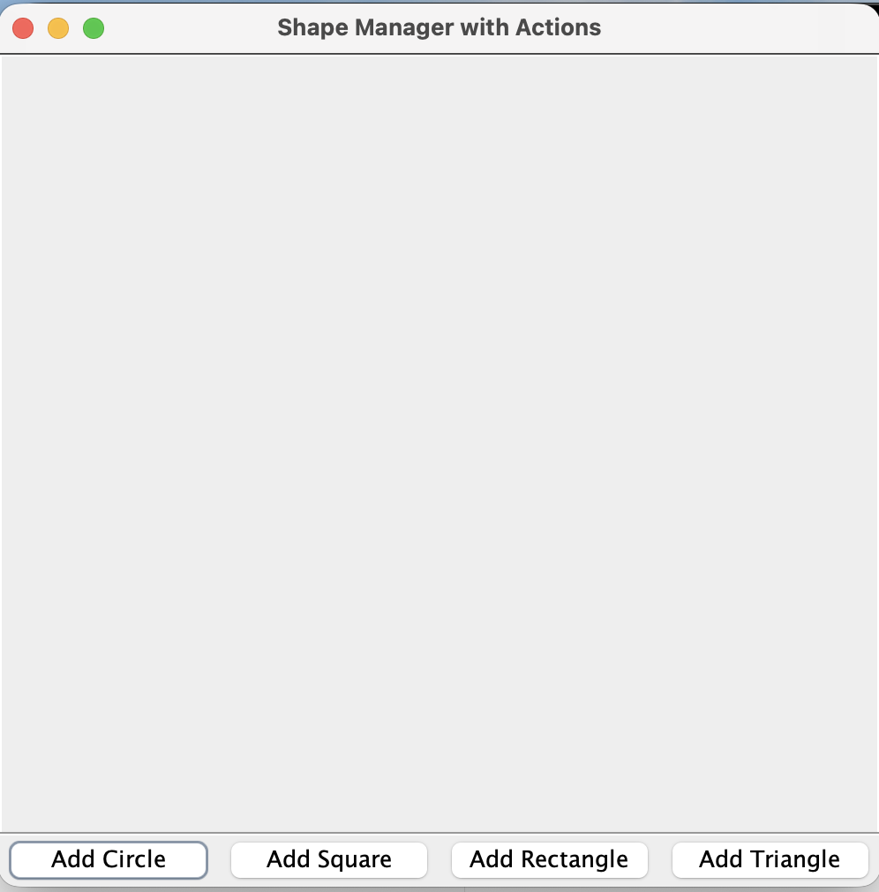
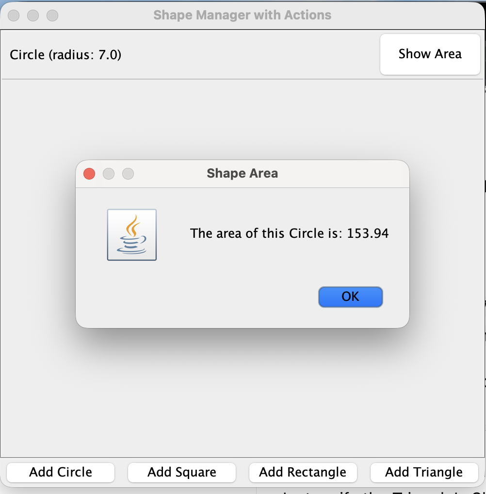
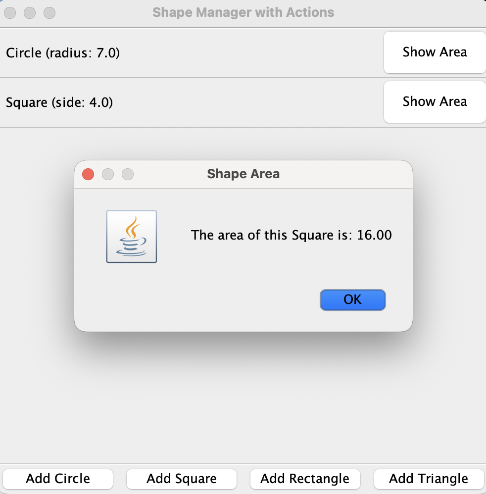
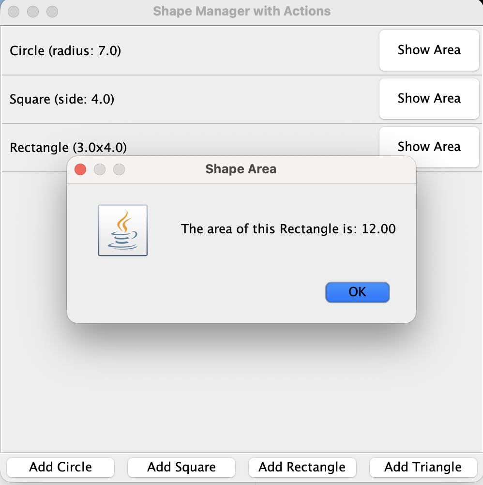

# Shape List App

**CS3354 — Assignment 2 | Texas State University**

## Overview

Shape List App is a Java Swing application for creating and managing a list of shape objects: **Circle, Square, Rectangle, and Triangle**. Users enter each shape’s dimensions, view the shape information in a scrollable list, and click **Show Area** to see its calculated area in a dialog box.

The application represents shapes **as text entries rather than drawing geometric figures**. It demonstrates Java interfaces, classes, polymorphism, constructors, and method overriding.

## Features

- Add circles, squares, rectangles, and triangles with user-provided dimensions.
- Display each shape’s name and dimensions in a scrollable list.
- Calculate and display the area of each shape to two decimal places.
- Keep multiple shape objects in the same window.

## Screenshots

### Main Application Window



### Circle Area

Circle



### Square Area

Square



### Rectangle Area

Rectangle




## Project Structure

```text
Shape-List-App/
├── src/
│   └── edu/
│       └── txst/
│           └── assignment2/
│               ├── Shape.java
│               ├── Circle.java
│               ├── Square.java
│               ├── Rectangle.java
│               ├── Triangle.java
│               └── ShapeManager.java
├── screenshots/
│   ├── 01-empty-window.png
│   ├── 02-circle-area.png
│   ├── 03-square-area.png
│   ├── 04-rectangle-area.png
│   └── 05-all-four-shapes.png
├── run.sh
└── README.md
```

## Java Classes

| File | Description |
| --- | --- |
| `Shape.java` | Interface declaring `getArea()` and `getClassName()`. |
| `Circle.java` | Circle object with area formula π × radius². |
| `Square.java` | Square object with area formula side². |
| `Rectangle.java` | Rectangle object with area formula width × length. |
| `Triangle.java` | Triangle object with area formula ½ × base × height. |
| `ShapeManager.java` | Instructor-provided Swing GUI for adding shape entries and showing areas. |

Each concrete shape class implements `Shape` and overrides `toString()` to display its dimensions.

## Requirements

- Java Development Kit (JDK), with `java` and `javac` available in the terminal
- macOS or Linux with Bash and a graphical desktop environment

## Running the Application

Clone the repository and enter the project directory:

```bash
git clone https://github.com/yubrajbajagain2024-byte/Shape-List-App.git
cd Shape-List-App
```

Start the application:

```bash
bash run.sh
```

The script generates a temporary package-compatible copy of the instructor-provided `ShapeManager.java`, compiles the Java classes, and launches the Swing application. The **original instructor file is kept unchanged**.

## Using the Application

1. Click **Add Circle**, **Add Square**, **Add Rectangle**, or **Add Triangle**.
2. Enter the requested dimension or dimensions.
3. View the new entry in the shape list.
4. Click **Show Area** next to an entry to display its calculated area.

## Team Members

- Manita Bista
- Yubraj Bajagain
- Sanskar Ghimire
- Darwin W Buchheit
- Mathew Rodriguez
